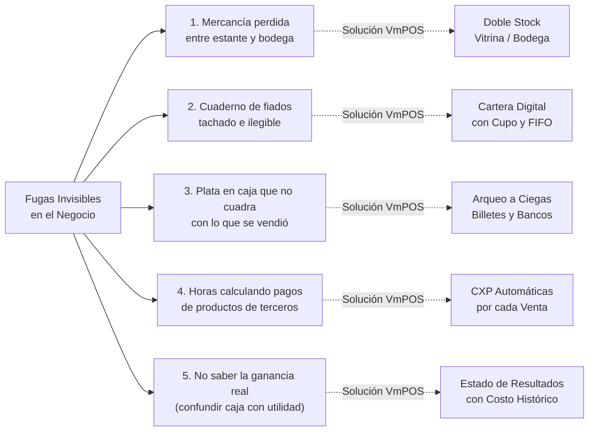

# VmPOS — EL SISTEMA POS DEFINITIVO PARA COMERCIOS QUE QUIEREN CRECER
### Control Total de Inventario, Ventas, Fiados y Ganancias Reales en su Negocio

**Propuesta Comercial y Guía de Beneficios para Establecimientos Minoristas**  
*Papelerías • Tiendas y Minimercados • Droguerías • Variedades y Cosméticos • Ferreterías • Negocios con Venta en Consignación*

---

## 1. RESUMEN EJECUTIVO: ¿POR QUÉ VmPOS?

En el comercio minorista actual, **vender más no siempre significa ganar más**. Muchos comerciantes trabajan jornadas de más de 12 horas, ven pasar millones de pesos por sus manos, pero al final del mes no saben exactamente cuánto dinero les quedó limpio, cuánto tienen retenido en fiados a vecinos, o cuánto deben a proveedores.

**VmPOS** es el software de punto de venta e inventario diseñado específicamente para ponerle fin al desorden administrativo, los cuadernos de papel y las pérdidas invisibles de mercancía y dinero.

A diferencia de los sistemas tradicionales lentos o los programas en la nube que cobran costosas mensualidades en dólares y dejan de funcionar si se cae el internet, **VmPOS es un software de alto rendimiento que corre directo en su computador:**
- ⚡ **Ultra rápido:** Atienda y cobre en menos de 5 segundos por cliente.
- 📶 **100% Blindado contra caídas de internet:** Venda sin interrupciones incluso si el barrio se queda sin red.
- 📦 **Control de doble stock (Vitrina vs Bodega):** Sepa qué tiene en el estante y qué tiene guardado en cajas.
- 🤝 **Gestión automática de productos en consignación:** Liquide en un clic las comisiones de terceros.
- 💎 **Fiados y cartera bajo control matemático:** Cupos máximos de crédito por cliente y abonos ordenados.
- 💵 **Arqueo de caja a ciegas:** Elimine de raíz los descuadres y sospechas entre cajeros.

---

## 2. LOS 5 DOLORES DE CABEZA DEL COMERCIANTE Y CÓMO LOS CURA VmPOS

### 1. "No sé si tengo mercancía en la bodega o si ya se me acabó en el mostrador"
- **El problema:** Se compra mercancía repetida porque se creía agotada cuando en realidad estaba guardada en cajas de bodega; o se pierden ventas porque el estante está vacío y nadie fue a surtir.
- **La solución VmPOS:** Separa con total claridad el **Stock de Vitrina** (lo que está exhibido) del **Stock de Bodega** (lo que está guardado). Cuando la vitrina se agota, el sistema emite una alerta y permite hacer un traslado formal de bodega a mostrador con un solo clic.

### 2. "Llevar los fiados en cuadernos me hace perder clientes y plata"
- **El problema:** Anotaciones borrosas en papel, hojas que se rompen, clientes que niegan deudas viejas y pagos parciales que nadie sabe a qué factura aplicar.
- **La solución VmPOS:** Ficha digital para cada cliente con cupo de crédito máximo. Si el cliente supera su límite, el sistema bloquea el fiado. Cuando el cliente abona dinero, el sistema descuenta las facturas más antiguas en orden y le entrega una tirilla impresa con su abono y su saldo restante exacto.

### 3. "La caja nunca cuadra al final del día y hay discusiones con los cajeros"
- **El problema:** Cajeros que pagan fletes, compras o almuerzos con dinero de la venta y olvidan anotarlo; o cajeros que cuadran los números en el papel para que parezca que todo coincide.
- **La solución VmPOS:** **Arqueo a Ciegas**. Al cerrar turno, el cajero debe ingresar físicamente cuántos billetes y monedas tiene en las manos sin ver la cifra del sistema. El sistema compara contra ventas, gastos registrados y abonos, revelando si falta o sobra plata al centavo.

### 4. "Vendo productos que me dejan en consignación y liquidarles es una pesadilla"
- **El problema:** Artesanos, reposteros o distribuidores que dejan mercancía en el local. A fin de mes toca ponerse a buscar papelitos para saber cuántos se vendieron y cuánto pagarles.
- **La solución VmPOS:** Cada vez que el cajero pasa un producto en consignación por el lector, VmPOS calcula la comisión del negocio y genera automáticamente la cuenta por pagar al proveedor. Al final del mes, se liquida con un solo clic y se imprime el comprobante de pago.

### 5. "Miro la caja llena pero no sé si de verdad estoy ganando plata"
- **El problema:** Confundir el dinero que entra a la caja con la ganancia. Gran parte de ese dinero es costo de reposición de mercancía que se debe a distribuidores. Gastárselo es descapitalizar el negocio.
- **La solución VmPOS:** El módulo de **Contabilidad Central** calcula el Costo de la Mercancía Vendida (COGS) producto por producto, resta los gastos de operación del local y le muestra en pantalla la **Ganancia Neta Real y su Margen de Rentabilidad**.

---

## 3. LAS 15 GRANDES RAZONES PARA ELEGIR VmPOS

1. **Velocidad Extrema en Mostrador:** Diseñado para funcionar 100% con teclado y lector de código de barras. Una venta completa toma menos de 5 segundos.
2. **Independencia Total de Internet:** Si la red se cae, su negocio no se detiene. VmPOS funciona de forma nativa en su computador.
3. **Control Doble de Stock (Vitrina y Bodega):** Nunca más vuelva a perder ventas por no saber qué tiene guardado en sus cajas de reserva.
4. **Cuentas por Pagar Automáticas (Consignaciones):** Liquidación matemática de proveedores externos sin perder horas haciendo cuentas a mano.
5. **Cartera Blindada con Límite de Crédito:** Defina cuánto es lo máximo que le puede fiar a cada persona y evite que sus empleados fíen de más.
6. **Abonos Inteligentes FIFO:** Al abonar, el sistema cancela primero las deudas más viejas y emite comprobante con el nuevo saldo para tranquilidad del cliente.
7. **Arqueo Físico a Ciegas:** El método más seguro del mundo contra descuidos y fraudes en la caja registradora.
8. **Facturas de Distribuidor con Factor de Conversión:** Compre por cajas o fardos y el sistema los ingresa automáticamente como unidades sueltas con su costo exacto.
9. **Anulación Transparente y Auditoría Total:** Si se cancela una venta por devolución, el inventario regresa al estante, la deuda del proveedor se descuenta y queda grabado quién autorizó la orden.
10. **Generador e Impresor de Códigos de Barras Propio:** Cree y pegue etiquetas de código de barras con precio y nombre en productos que no traen código de fábrica.
11. **Manejo de 'Precios Varios' en Vivo:** Cobro ágil de fotocopias, servicios técnicos o artículos a granel donde el precio cambia según el cliente.
12. **Cola de Turnos para Empleados:** Asignación circular de clientes en papelerías o centros de copiado para evitar preferencias y distribuir el trabajo parejo.
13. **Asistencia y Nómina Diaria Automática:** El sistema marca la llegada del empleado al hacer su primera venta del día y va acumulando sus sueldos y comisiones.
14. **Personalización Total (Marca Blanca):** Su logotipo, datos de contacto, NIT y mensajes de agradecimiento o garantía en cada tirilla impresa.
15. **Multiplataforma sin Cambiar de Equipo:** Compatible tanto con computadores Windows 10/11 como con portátiles Mac (Apple Silicon e Intel).

---

## 4. IMPACTO ECONÓMICO: ¿CUÁNTO DINERO LE AHORRA VmPOS CADA MES?

En un negocio promedio de mostrador (ventas de $15.000.000 a $30.000.000 COP al mes), los comerciantes experimentan pérdidas silenciosas:

| Fuga Típica en un Negocio Tradicional | Pérdida Estimada Mensual | Con VmPOS en su Negocio |
| :--- | :---: | :---: |
| **Robos hormiga y pérdidas de mercancía en bodega** | $250.000 – $500.000 COP | **$0** (Control estricto de doble stock y traslados) |
| **Fiados olvidados o cuentas no cobradas** | $300.000 – $600.000 COP | **$0** (Tope máximo de crédito y abonos con recibo) |
| **Descuadres en caja por gastos de bolsillo no anotados** | $150.000 – $350.000 COP | **$0** (Arqueo a ciegas y registro obligatorio de egresos) |
| **Horas de trabajo manual cuadrando cuentas y nóminas** | 25 a 40 horas al mes | **Ahorro del 90% del tiempo** (Liquidación en 1 clic) |
| **Ventas perdidas por caídas de internet en sistemas nube** | $200.000 – $400.000 COP | **$0** (Operación 100% nativa fuera de línea) |
| **TOTAL DINERO RECUPERADO AL MES:** | **$900.000 – $1.850.000 COP** | **El sistema se paga solo desde el primer mes** |

---

## 5. ADAPTABILIDAD PROBADA POR SECTOR

### Papelerías y Centros de Copiado
- Cobro instantáneo de fotocopias, anillados e impresiones con precios varios.
- Gestión de cola de turnos para que los operarios atiendan en orden.
- Impresión de códigos de barras para cuadernos, carpetas y pliegos de cartulina.

### Tiendas de Barrio y Minimercados
- Facturación rápida con escáner para despachar clientes en fila.
- Ingreso de pacas de gaseosa o abarrotes convertidas a unidades para la bodega.
- Registro estricto de deudas fiadas a vecinos y cuadre de caja nocturno.

### Droguerías y Farmacias
- Búsqueda veloz de medicamentos por nombre comercial o código de barras.
- Monitoreo del costo unitario histórico para no perder margen frente a alzas de laboratorio.
- Tirillas térmicas claras con desglose de la compra para el paciente.

### Tiendas de Variedades, Joyería y Cosméticos
- Control automático de productos en consignación de aliados y artesanos.
- Liquidación mensual de cuentas por pagar en un solo clic con comprobante.
- Etiquetado adhesivo de accesorios pequeños con precio visible.

### Ferreterías de Mostrador
- Separación real de tornillería en vitrina y bultos de cemento en bodega.
- Cupo de crédito para maestros de obra y constructores aliados.

---

## 6. PREGUNTAS FRECUENTES DE LOS COMERCIANTES

**¿Necesito comprar un computador nuevo y costoso?**  
No. VmPOS está optimizado para consumir muy pocos recursos. Funciona perfectamente en computadores Windows 10/11 estándar o portátiles Mac que ya tenga en su negocio.

**¿Qué pasa si se va el internet en mi local?**  
Absolutamente nada. VmPOS no depende de internet para facturar, descontar inventario ni hacer cierres de caja. Su negocio sigue vendiendo con normalidad.

**¿Qué tipo de impresora necesito?**  
Cualquier impresora térmica estándar de tirillas (de 58 mm o de 80 mm) con conexión USB, de red o Bluetooth (marcas como Epson, Xprinter, Bixolon, Pos-D o genéricas). También puede generar recibos en PDF para impresoras de oficina.

**¿Es difícil de aprender a usar para mis empleados?**  
No. La pantalla de ventas está diseñada para usarse en menos de 10 minutos de capacitación. Es intuitiva, cuenta con iconos claros y atajos de teclado rápidos.

**¿Puedo usar mi pistola lectora de códigos de barras actual?**  
Sí. Cualquier lector de códigos de barras USB o inalámbrico es compatible de inmediato sin instalar controladores adicionales.

**¿Mis datos están seguros si se daña el computador?**  
Totalmente. Toda la información de su negocio se almacena en bases de datos locales que usted puede respaldar en una memoria USB o sincronizar con su cuenta de Google Drive o Dropbox en segundos.

---

## 7. EL SIGUIENTE PASO: AGENDE SU DEMOSTRACIÓN

No permita que un día más de desorden en cuadernos o cajas descuadradas le siga costando dinero a su negocio.

Dé el salto a la administración profesional, moderna y sin estrés con **VmPOS**.

👉 **¡Contáctenos hoy mismo para agendar una demostración en vivo y ver cómo VmPOS transforma su establecimiento comercial!**
